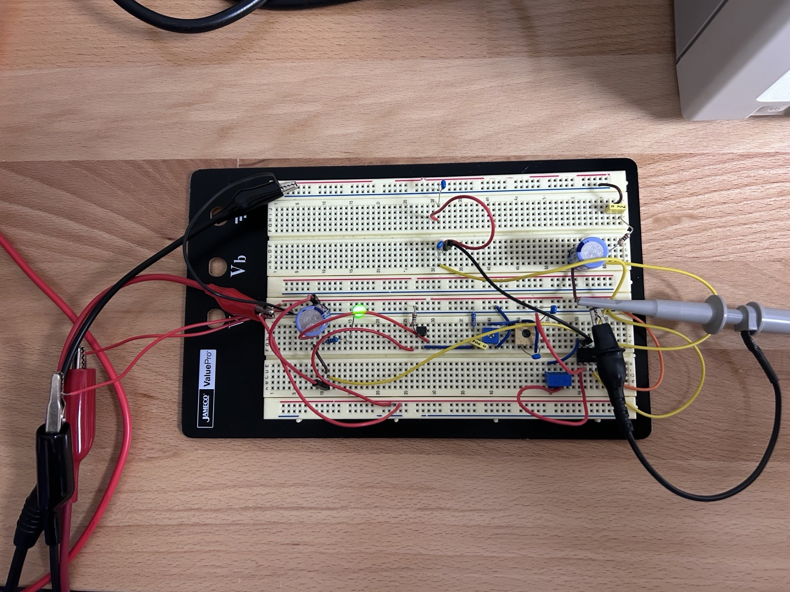

# EE 2240 · ½ W Guitar Amplifier

A sophomore design project to explore a compact, battery-powered guitar amplifier. The repository brings together circuit simulations, a KiCad board design, and a prototype enclosure inspired by the Noisy Cricket Mk II.



*Breadboard work from the project journal. The photo records a development setup; it does not establish that this circuit matches the final PCB.*

## The project

The amplifier is designed around a 9 V supply and an 8 Ω speaker load. Its signal path uses a JFET input stage, volume and tone controls, and an LM386 power amplifier. Gain and grit controls provide additional ways to shape the sound. The team explored the circuit in Multisim and on the bench, then developed a PCB and an enclosure concept.

The amplifier has a **½ W output power target**. The files here do not establish measured output power.

| Area | What is here | Guide |
| --- | --- | --- |
| Circuit studies | Multisim models and saved results for the complete circuit and individual stages | [Simulations](src/simulations/README.md) |
| Board | KiCad schematic, board layout, and supplied Gerber archive | [PCB](src/pcb/README.md) |
| Enclosure | Parametric CAD source, STEP solids, and STL meshes | [CAD](src/cad/README.md) |
| Project work | Selected breadboard and oscilloscope photos from the journal | [Photo record](docs/photos/README.md) |

## Design and testing status

- The [PCB project](src/pcb/README.md) contains the updated board design. KiCad checks report schematic and parity findings that need review, and the supplied Gerber archive has not been verified against the current layout. The journal photos do not identify the board revision or test conditions.
- The enclosure is a **fit-check concept**. Its dimensions, control openings, and mounting must be checked against the actual board and hardware before use.
- Saved simulations and oscilloscope photos document work in progress. They do not by themselves verify output power, distortion, or final board performance.

## Explore the files

Open the board project in KiCad 10, and open the `.ms14` models in a compatible version of NI Multisim. The enclosure's STEP and STL files can be inspected in CAD and mesh viewers; [its guide](src/cad/README.md#edit-and-regenerate) explains how to regenerate them with CadQuery.

```text
src/
├── cad/          Enclosure model and exports
├── pcb/          KiCad project and supplied Gerber archive
└── simulations/  Circuit models and saved results
docs/photos/      Selected journal images
```

To continue the project, test the assembled circuit with a known supply and load, and adapt the enclosure to the actual hardware. Record the test conditions alongside any measurements.
