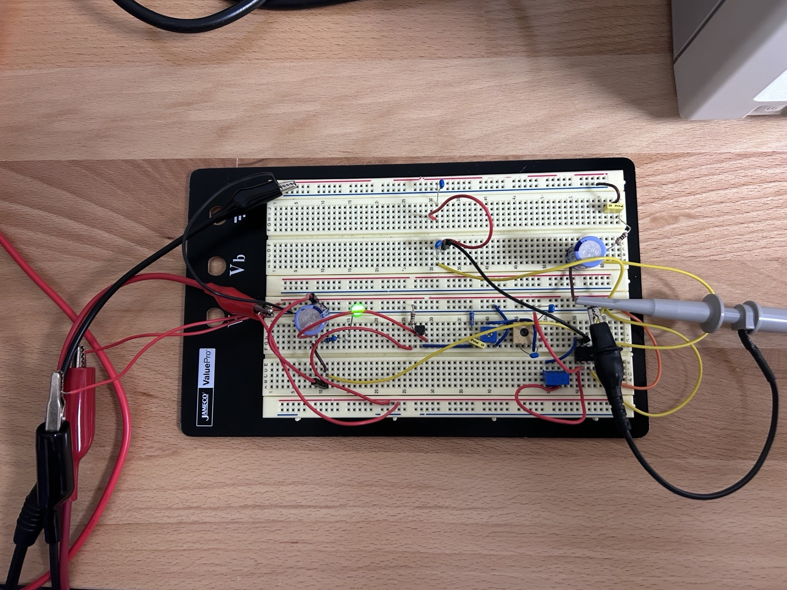
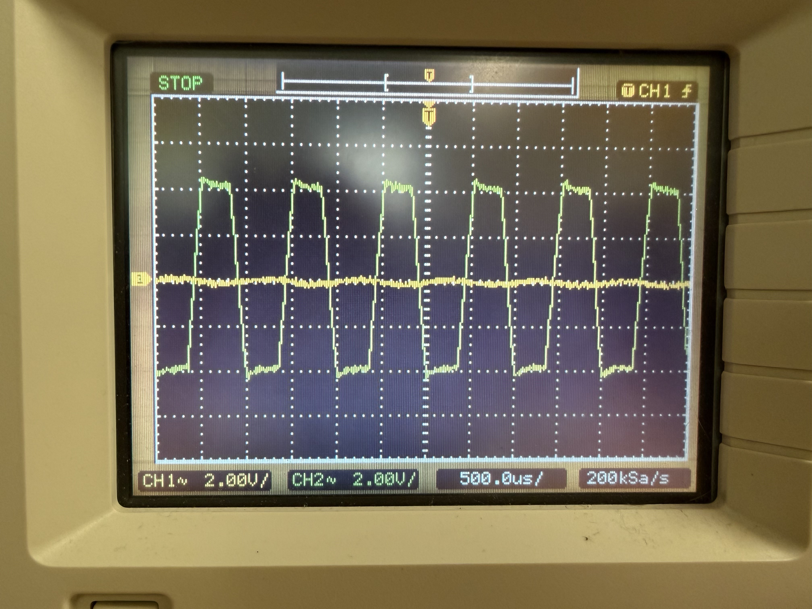

# Project photo record

[Project overview](../../README.md)

These photos from the project journal show circuit development and bench testing. The images do not identify the circuit revision, probe locations, or test settings, so they cannot establish final board performance.

## Breadboarding

A breadboard setup used during development. Its relationship to the final PCB has not been confirmed.

## Bench testing

An oscilloscope capture from bench work. The measured nodes and test conditions are not identified in the image.
