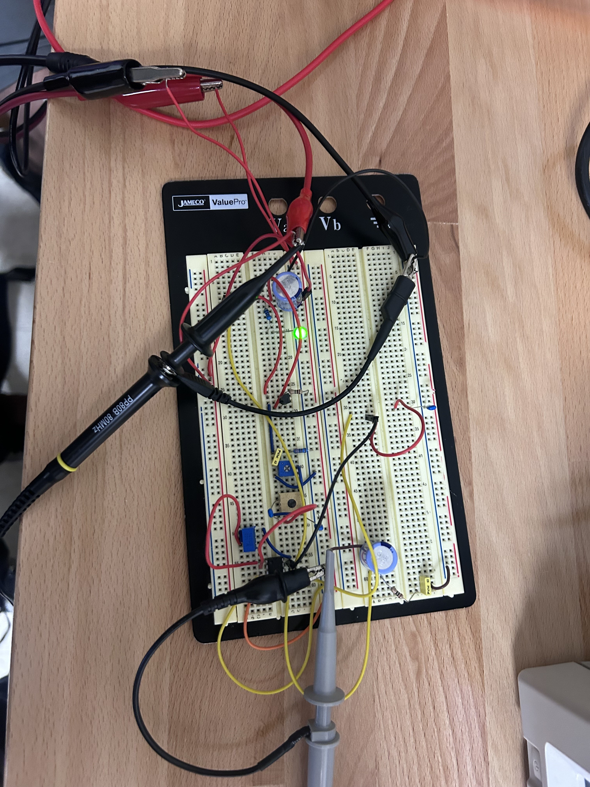
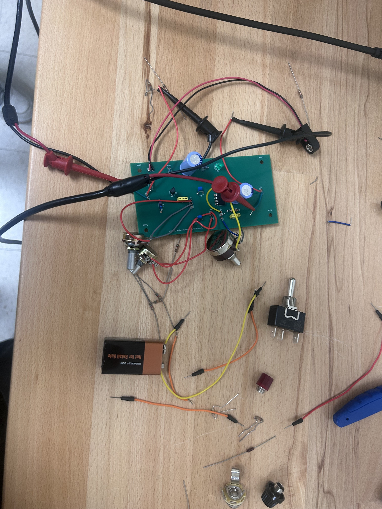
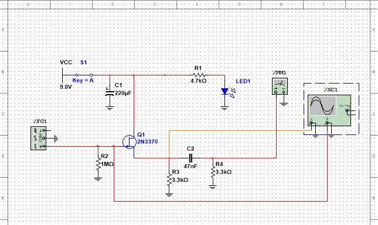

# Project photo record

[Project overview](../../README.md)

These selected images were downloaded from the project journal. They show development work, but the exported filenames did not include dates, circuit revisions, probe locations, or test settings. Add that context from the journal before using the images as evidence for a performance claim.

## Breadboarding

A breadboard setup with test leads attached. This development setup has not been confirmed to match the final PCB.

Another view of breadboard work. Its relationship to the first setup has not been confirmed.

## Other bench work

A board and connected test leads. The board revision and test conditions are not identified by the image alone.

An oscilloscope capture from bench work. The measured nodes and circuit conditions are not recorded with this image.

## Simulation work

A circuit and virtual instruments from the journal. Check the corresponding Multisim model and settings before comparing it with the board schematic or interpreting results.
