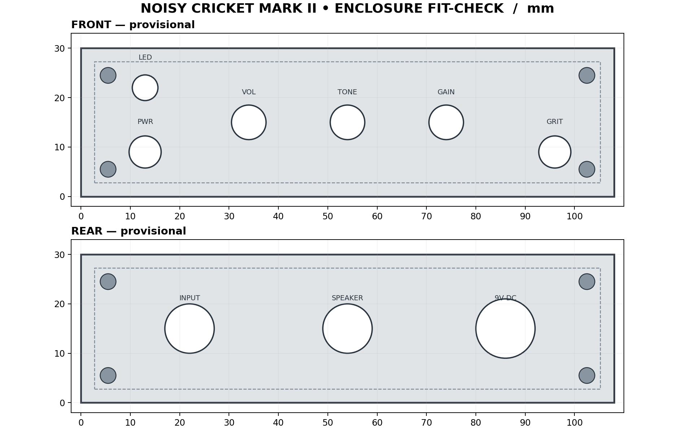

# CAD · Amplifier Enclosure

[Project overview](../../README.md) · [PCB](../pcb/README.md) · [Simulations](../simulations/README.md)

A Noisy Cricket Mark II-inspired enclosure generated with CadQuery: one hollow shell and two removable end panels. This is a **conceptual fit-check prototype**; the PCB, controls, and connectors have not been physically fitted.



*Panel layout in the model's X/Z coordinates. The rear panel is shown in the same coordinate system, not mirrored as an outside-facing rear view.*

## Files and workflow

| File | Purpose |
| --- | --- |
| [model.py](model.py) | Parametric source; dimensions, holes, fasteners, and exports |
| [assembly.step](assembly.step) | Complete assembly for CAD inspection |
| [shell.step](shell.step), [front_panel.step](front_panel.step), [rear_panel.step](rear_panel.step) | Separate solid parts for CAD exchange |
| [shell.stl](shell.stl), [front_panel.stl](front_panel.stl), [rear_panel.stl](rear_panel.stl) | Individual meshes for slicing and printing |
| [assembled_preview.stl](assembled_preview.stl) | Assembly visualization only; do not print as one piece |
| [preview.scad](preview.scad) | OpenSCAD preview that colors the three STL parts |
| [panel_layout.png](panel_layout.png) | Reference drawing; update separately when geometry changes |

## How it assembles

The shell is open along its depth. Four lengthwise screw columns support the front and rear panels, which sit flush at the enclosure ends. Panel clearance holes align with pilot bores in these columns. Shallow grooves decorate the top; they are not ventilation slots.

The front panel has openings for an LED, power switch, volume, tone, gain, and a provisional Grit switch. The rear panel has audio input, speaker output, and DC input openings. **The current PCB has no Grit switch connection**, so this cutout needs to be reconciled before printing.

| Parameter | Current value |
| --- | --- |
| Outside dimensions (width × depth × height) | 108 × 80 × 30 mm |
| Shell wall / panel thickness | 2.5 / 2.5 mm |
| Panel clearance | 0.25 mm per side |
| Panel fastener hole / column pilot diameter | 3.2 / 2.3 mm |
| Fastener centers (X, Z) | (5.5, 5.5), (102.5, 5.5), (5.5, 24.5), (102.5, 24.5) mm |
| Top grooves (width × depth) | 1 × 0.55 mm |

Coordinates are in millimeters: **X** left to right, **Y** front to rear, **Z** bottom to top. The front outside face is Y = 0; the rear outside face is Y = 80.

### Panel openings

Centers below use the same X/Z coordinates as `model.py`.

| Panel | Feature | Center (X, Z), mm | Diameter, mm |
| --- | --- | --- | --- |
| Front | LED | (13, 22) | 5.2 |
| Front | Power | (13, 9) | 6.5 |
| Front | Volume / tone / gain | (34, 15) / (54, 15) / (74, 15) | 7.0 each |
| Front | Grit (provisional) | (96, 9) | 6.5 |
| Rear | Audio input / speaker output | (22, 15) / (54, 15) | 10.0 each |
| Rear | DC input | (86, 15) | 12.0 |

## Edit and regenerate

With Python and CadQuery installed, run from the repository root:

```sh
python src/cad/model.py
```

Edit dimensions and hole lists in `model.py` first. Running it overwrites the STEP and STL exports in this directory, checks that each part is a valid solid with positive volume, and prints its volume and bounding dimensions. It does not check hardware fit or regenerate the panel drawing.

Open `assembly.step` in a CAD viewer to inspect the solids, or open `preview.scad` in OpenSCAD beside the STL files to view the colored assembly.

## Fit checks before printing

1. Compare the [PCB](../pcb/README.md)'s approximately **90.31 × 46.79 mm** outline with the intended mounting orientation and component heights. Panel holes do not establish PCB alignment.
2. Check potentiometer shafts, switch bodies, jacks, and internal wiring against actual hardware. The 30 mm outside height may be restrictive.
3. Add PCB supports as needed; there are no standoffs, battery compartment, or heatsink provisions in this model.
4. Print the panels first to test hole sizes and alignment. Test the 2.3 mm screw pilots separately; they are provisional thread-forming holes, not calibrated heat-set-insert pockets.
5. Slice the three individual part meshes after fit checks. Address insulation and grounding in the assembly; a plastic enclosure does not provide metal-enclosure shielding.
