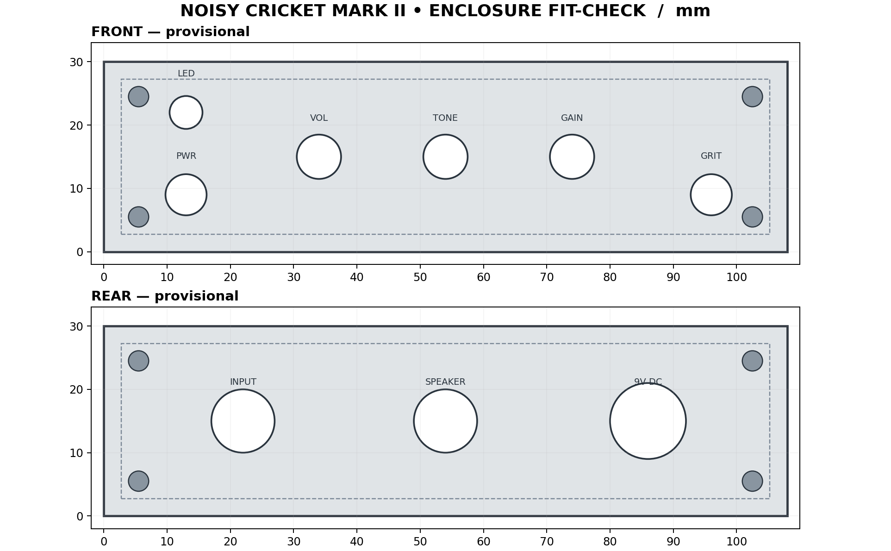

# Noisy Cricket Mark II — Initial 3D-printable enclosure

**Status:** Initial conceptual fit-check prototype, NOT verified against the original Mark II mechanical assembly. Dimensions/hole layout are provisional and must be checked against real PCB/controls/jacks before printing a functional enclosure.

*Provisional panel layout; verify the openings and board fit against the actual hardware.*

## Parts and files
- `assembly.step`: Complete enclosure positioned as assembled; editable/importable CAD solids.
- `shell.step` / `front_panel.step` / `rear_panel.step`: Separate STEP solids.
- `shell.stl` / `front_panel.stl` / `rear_panel.stl`: Individual printable meshes. **Do not print `assembled_preview.stl` as one piece.**
- `model.py`: Editable parametric CadQuery generation source (Python + CadQuery).

## Coordinates / dimensions
- X: left → right, Y: front → rear, Z: bottom → top, in mm.
- Outer bounding box: **108 W × 80 D × 30 H mm**.
- Walls: 2.5 mm; removable panels: 2.5 mm, recessed flush at both ends.
- Clearance around panels: 0.25 mm per side.
- Front panel outside: Y=0; rear outside: Y=80.
- Decorative top grooves: 1 mm wide, 0.55 mm deep.
- Fastener center positions on each panel (X,Z): (5.5,5.5), (102.5,5.5), (5.5,24.5), (102.5,24.5).
- Fasteners: 3.2 mm clearance panel holes; 2.3 mm diameter pilot through boss. **This is a screw-pilot trial, not a calibrated M3 heat-set-insert fit.** Consider self-tapping screws or revise boss dimensions for inserts.

### Front controls (X, Z center in mm; diameter in mm)
| Feature | X | Z | diameter |
|---|---:|---:|---:|
| LED | 13 | 22 | 5.2 |
| Power | 13 | 9 | 6.5 |
| Volume | 34 | 15 | 7.0 |
| Tone | 54 | 15 | 7.0 |
| Gain | 74 | 15 | 7.0 |
| Grit | 96 | 9 | 6.5 |

### Rear controls (X, Z center in mm; diameter in mm)
| Feature | X | Z | diameter |
|---|---:|---:|---:|
| Audio input | 22 | 15 | 10.0 |
| Speaker out | 54 | 15 | 10.0 |
| DC jack | 86 | 15 | 12.0 |

## Engineering cautions
- The current [PCB layout](../pcb/README.md) has an approximately 121.51 × 60.39 mm outline. Its long edge exceeds both the enclosure's 108 mm outside width and 80 mm outside depth. An axis-aligned horizontal installation will not fit; check any other orientation, internal clearance, and mounting before adapting the enclosure.
- In particular, potentiometer placement and shaft alignment have **not** been verified, nor have the actual switch/jack cutout diameters.
- Rear connectors and control bodies require internal clearance testing; the 30 mm height may be insufficient with some off-the-shelf parts.
- No slots, standoffs, battery compartment or heatsink are included yet.
- Boss pilots need print testing; selected nominal 2.3 mm diameter for possible thread-forming trial and not heat-set inserts.
- Do not assume PETG enclosure provides shielding or grounding equivalent to aluminum; address electrical insulation and grounding during actual build.

Suggested iteration: print panels first and physically verify hardware fit, then adapt overall dimensions and support features based on the actual components.

## Edit and regenerate

Install CadQuery in a Python environment, then run `python model.py` from this directory. The script writes the STEP and STL exports next to the model, replacing the existing exports. Review the resulting geometry and fit after making changes. `preview.scad` and `panel_layout.png` are included as supplementary preview files.
