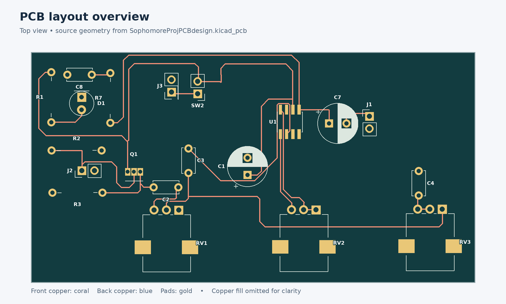

# PCB · Amplifier Circuit & Layout

[Project overview](../../README.md) · [Simulations](../simulations/README.md) · [CAD](../cad/README.md)

A 9 V amplifier built around a JFET input stage and an LM386, with volume, tone, and gain controls. The project targets **1 W output**; measured power and audio performance are not established by these files.

*Simplified preview drawn from the checked-in PCB geometry. Copper fill is omitted for readability; use KiCad for complete layers, pad details, and fabrication review.*

## Project files

| File | Purpose |
| --- | --- |
| [SophomoreProjPCBdesign.kicad_pro](SophomoreProjPCBdesign.kicad_pro) | Project settings; open this first |
| [SophomoreProjPCBdesign.kicad_sch](SophomoreProjPCBdesign.kicad_sch) | Circuit schematic and component values |
| [SophomoreProjPCBdesign.kicad_pcb](SophomoreProjPCBdesign.kicad_pcb) | Footprints, copper routing, ground zone, and outline |
| `SophomoreProjPCBdesign.kicad_prl` | Local editor preferences |

The design was saved with **KiCad 10.0**. Use that version or a compatible newer release. Open the `.kicad_pro` file, then launch the schematic or PCB editor. The PCB editor's 3D Viewer can help inspect component orientation; models depend on installed KiCad libraries.

## Signal path

1. **Input — J2, Q1, R2, R3:** J2 feeds the JFET gate. R2 references the gate to ground, and R3 connects the source to ground. The drain connects to the switched supply, making this a source-follower input stage.
2. **Volume — C2, RV1:** C2 couples the source signal into the 10 kΩ volume potentiometer. Its wiper feeds the next stage through C3.
3. **Tone — RV3, C4:** The 100 kΩ potentiometer and 100 nF capacitor form an adjustable path from the volume-wiper node to ground, shaping high-frequency content.
4. **Amplification — U1, RV2:** C3 feeds LM386 pin 2; pin 3 is grounded. The 1 kΩ RV2 connects between gain pins 1 and 8. Pin 7 (bypass) is unconnected in this design.
5. **Output — C7, J1:** The LM386 output at pin 5 passes through the 220 µF coupling capacitor to J1. R7 and C8 form a series RC branch from the amplifier output to ground.

J3 supplies 9 V through external power switch SW2. C1 provides supply decoupling; R1 and D1 form the power-indicator branch.

### Controls and component values

Control roles below follow the current pad-net connections: **RV2 is gain; RV3 is tone**.

| Reference | Value / role |
| --- | --- |
| Q1 | Generic N-channel JFET symbol; select and verify an actual part |
| U1 | LM386, SOIC-8 footprint |
| RV1 | 10 kΩ — volume |
| RV2 | 1 kΩ — gain, between LM386 pins 1 and 8 |
| RV3 | 100 kΩ — tone, in series with C4 to ground |
| R1 / R2 / R3 / R7 | 4.7 kΩ / 1 MΩ / 3.3 kΩ / 10 Ω |
| C1 / C7 | 220 µF, polarized |
| C2 / C8 | 47 nF |
| C3 / C4 | 100 nF |
| D1 | 5 mm power LED |

This is a design-value reference, not a purchasing BOM. Verify voltage and power ratings, dimensions, the selected JFET's pinout, and the LM386 package before ordering parts.

## External connections

Pin numbers below are **footprint pad numbers**, read from the PCB nets. Check pad orientation in KiCad before wiring.

| Connection | Function | Pad 1 | Pad 2 |
| --- | --- | --- | --- |
| J1 | Speaker output | Output through C7 | Ground |
| J2 | Audio input | Q1 gate | Ground |
| J3 | DC power input | +9 V | Ground |
| SW2 | External SPST power switch | +9 V input | Switched circuit supply |

J1 and J2 use two-pin, 2.54 mm headers for wiring external jacks, despite the `AudioJack2` schematic values. SW2 also uses a two-pin header. The PCB has no dedicated Grit switch connection.

## Mechanical details

| Property | Current design |
| --- | --- |
| Board outline | Approximately 90.31 × 46.79 mm, rectangular |
| Copper stack | Two layers; configured thickness 1.6 mm with FR4 core |
| Assembly | Mostly through-hole; U1 is surface-mount SOIC-8 |
| Potentiometer footprints | Alpha RD901F-40-00D single vertical |
| Routing | Routed tracks and a ground copper zone are present |

The [enclosure](../cad/README.md) is a provisional model. Verify board orientation, shaft spacing, connector bodies, and component heights against it; the panel layout does not establish compatibility with this PCB.

## Before fabrication

1. Run the schematic Electrical Rules Checker (ERC) and review the findings.
2. Confirm schematic/PCB agreement, refill copper zones, and run the Design Rules Checker (DRC), including unconnected-item checks.
3. Verify connector orientation, Q1 pinout, U1 pin 1, LED polarity, and electrolytic polarity against the selected parts.
4. Check the footprint dimensions and enclosure clearances using actual hardware.
5. Export Gerbers and drill files, then inspect them in a Gerber viewer before ordering.
6. Before power-up, check for supply-to-ground shorts; use a current-limited 9 V supply for initial testing.

Fabrication exports, a manufacturer-specific BOM, and bench test results are not included. This documentation update does not certify ERC/DRC results or fabrication readiness.
