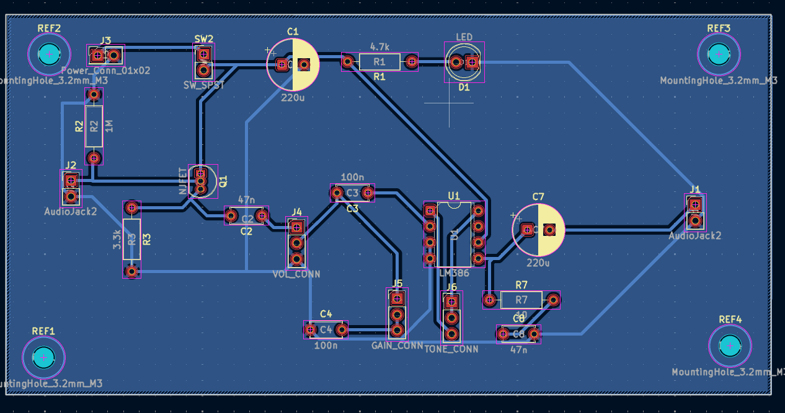

# PCB · Guitar amplifier

[Project overview](../../README.md) · [Simulations](../simulations/README.md) · [CAD](../cad/README.md)

This directory contains the supplied KiCad amplifier design. Open [pcb.kicad_pro](kicad/pcb.kicad_pro) in KiCad 10 to work with the schematic and board together.



*PCB layout image from the project journal. This is an earlier design image; use the KiCad files below for the current board.*

## Files

| File | Purpose |
| --- | --- |
| [pcb.kicad_pro](kicad/pcb.kicad_pro) | Project settings and entry point |
| [pcb.kicad_sch](kicad/pcb.kicad_sch) | Circuit schematic |
| [pcb.kicad_pcb](kicad/pcb.kicad_pcb) | Board layout |
| [Gerber-Files.zip](kicad/Gerber-Files.zip) | Supplied Gerber and drill archive |

The layout has two copper layers and a rectangular Edge.Cuts outline approximately 121.51 × 60.39 mm. It includes four mounting-hole footprints. Check the board and component clearances against the [enclosure concept](../cad/README.md) before building.

The supplied Gerber archive predates the current board file; its correspondence to the current layout has not been verified. Generate and review fresh fabrication and drill files from the current board before manufacturing.

## Design checks

Checks run with KiCad 10.0.8 on the supplied files produced these results:

- Board DRC: no violations and no unconnected items under the project's enabled rules.
- Schematic parity: four extra footprint warnings for REF1–REF4, the mounting holes.
- Schematic ERC: two errors for U1 pin 7 (BYPASS), reported as unconnected and undriven, and two AudioJack2 library-symbol mismatch warnings.

Review the findings and the project's ignored checks in KiCad before fabrication; a clean DRC alone would not establish that the circuit works. The checks can be repeated from the repository root:

```sh
kicad-cli pcb drc --schematic-parity -o /tmp/pcb-drc.rpt src/pcb/kicad/pcb.kicad_pcb
kicad-cli sch erc -o /tmp/pcb-erc.rpt src/pcb/kicad/pcb.kicad_sch
```

Review the generated reports for details and rerun the checks after changes. The CLI commands above write reports without modifying the design.
