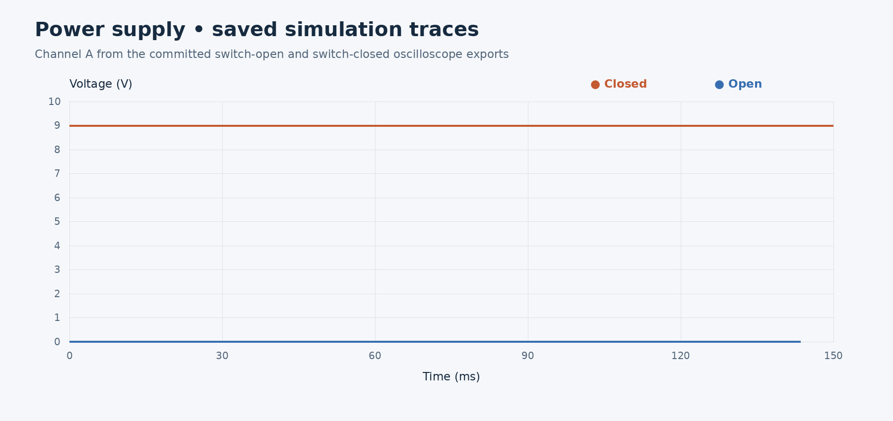

# Simulations · Circuit Studies

[Project overview](../../README.md) · [PCB](../pcb/README.md) · [CAD](../cad/README.md)

Multisim models explore the Noisy Cricket amplifier and its individual stages. Use the complete-circuit study for context, then open the focused models to investigate supply switching, the input stage, controls, and filtering.

*Plot of the first 150 ms of the committed [switch-open](PowerSupply/Results/PowerStageSwitchOpen.scp) and [switch-closed](PowerSupply/Results/PowerStageSwitchClosed.scp) exports, using their time and Channel A columns. The saved values are approximately 4.09 mV and 9 V respectively. These are saved simulation data, not a new run or bench measurements.*

## Model map

| Study | Model | What to inspect |
| --- | --- | --- |
| Complete circuit | [NoisyCricket/noisyCricket.ms14](NoisyCricket/noisyCricket.ms14) | Follow the overall circuit and compare it with the focused studies |
| Input stage | [PreampStage/preampStage.ms14](PreampStage/preampStage.ms14) | Input-stage waveform and bias behavior |
| Tone and volume | [ToneVolumeControl/toneVolumeControl.ms14](ToneVolumeControl/toneVolumeControl.ms14) | How control settings affect amplitude and frequency response |
| Power supply | [PowerSupply/powerstage.ms14](PowerSupply/powerstage.ms14) | Compare switch-open and switch-closed supply behavior |
| Power amplifier filtering | [PowerampBypass/noisyCricket.ms14](PowerampBypass/noisyCricket.ms14) | Compare the saved filter-on and filter-off cases |
| Earlier experiments | [deprecatedBuild/](deprecatedBuild/) | Historical preamp, gain, long-tailed-pair, output, and solid-state amplifier studies |

The two files named `noisyCricket.ms14` belong to different studies. Open them by their full paths. The `deprecatedBuild` folder preserves earlier work and is not the starting point for the current PCB.

## How the studies relate

The [PCB circuit](../pcb/README.md#signal-path) uses a JFET input stage to feed the volume control, an RC tone network to shape the signal, and an LM386 stage to drive the output. The supply study examines power switching independently; the control and filter studies explore changes around the audio path.

Treat the models as separate experiments. Their existence does not establish that every component value, connection, or switch option matches the current KiCad design. Compare each model with the schematic before using it to predict board performance.

## Open and run

1. Use NI Multisim capable of opening the **Multisim 14 `.ms14` format**. Work on a copy when saving from a newer release.
2. Open a model from the table and inspect its source, supply, load, control positions, and instrument connections.
3. Run the simulation and inspect the virtual instruments or analysis plots. Confirm which nodes each channel measures before interpreting the result.
4. Change one control or switch condition at a time; keep the other settings fixed for a useful comparison.
5. Save new results with the model revision, input amplitude/frequency, supply, load, control settings, and channel-to-node mapping.

No automated simulation runner is included. The models were not rerun as part of this documentation update.

## Reading the saved results

| Location | Contents |
| --- | --- |
| [PowerSupply/Results/](PowerSupply/Results/) | `PowerStageSwitchOpen.scp` and `PowerStageSwitchClosed.scp` |
| [PreampStage/Results/](PreampStage/Results/) | `PreampStageSims.scp` |
| [PowerampBypass/Results/](PowerampBypass/Results/) | `filteron.scp` and `filteroff.scp` |
| [ToneVolumeControl/Results/volume/](ToneVolumeControl/Results/volume/) | `.gra` exports for 0%, 25%, 50%, 75%, and 100% settings |
| [ToneVolumeControl/Results/tone/](ToneVolumeControl/Results/tone/) | `.gra` exports labeled by control percentage or 100 Hz, 1 kHz, and 5 kHz |

The current `.scp` exports are readable text: headers record timebase, channel scale, and connection status; rows contain time in seconds and channel voltages. Use the header to exclude disconnected channels even when a numeric column is present. Confirm probe locations in the model; channel letters alone do not identify input and output.

The `.gra` files are native graph exports for inspection in Multisim. Filenames identify saved cases, but do not fully record the setup. For comparisons, verify the source and load conditions in the corresponding model rather than inferring them from a filename.

Output-power and distortion claims require known test conditions and an identified output measurement. These saved studies alone do not verify the project's 1 W target.
